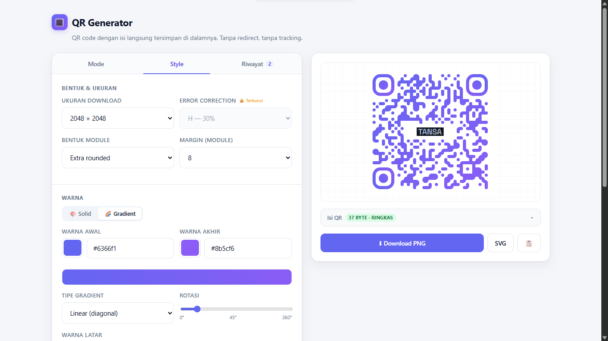

<div align="center">

# 🔳 QR Generator — Direct Link

**QR code generator yang menyimpan isi langsung ke dalam QR — bukan shortlink, bukan redirect.**

[](https://opensource.org/licenses/MIT)
[](https://developer.mozilla.org/en-US/docs/Web/JavaScript)
[]()
[]()
[](http://makeapullrequest.com)

[Coba Demo](#-demo) · [Fitur](#-fitur) · [Mode QR](#-mode-qr) · [Cara Pakai](#-cara-pakai) · [FAQ](#-faq) · [Lisensi](#-lisensi)

</div>

---

## 📖 Tentang Proyek

**QR Generator — Direct Link** adalah alat berbasis web yang membuat QR code dengan **isi asli langsung di-encode ke dalamnya**. Berbeda dengan kebanyakan QR generator online yang menyimpan shortlink milik mereka (dan mengarahkan ulang ke URL tujuan), alat ini menyimpan data asli secara permanen.

Artinya:

- ✅ QR berlaku **selamanya** — tidak peduli situs ini masih online atau tidak
- ✅ **Tanpa redirect**, tanpa perantara, tanpa iklan
- ✅ **Tanpa tracking** — tidak ada data yang dikirim ke server mana pun
- ✅ **100% berjalan di browser** — cukup buka `index.html`
- ✅ **Multi-mode** — bukan cuma URL, tapi juga WhatsApp, WiFi, vCard, dan lainnya

---

## ✨ Fitur

### 🎯 Mode QR (Multi-Tool)

Bukan hanya QR untuk URL — ini adalah **QR Tool Kit** dengan beberapa mode:

| Mode | Status | Deskripsi |
|---|---|---|
| 🔗 **URL** | ✅ Aktif | QR berisi URL asli, langsung ke tujuan |
| 💬 **WhatsApp** | ✅ Aktif | Chat langsung dengan nomor + pesan otomatis |
| 📶 **WiFi** | ✅ Aktif | Sambung WiFi tanpa ketik password (WPA/WEP/Terbuka) |
| 👤 **vCard** | ✅ Aktif | Kartu kontak — nama, telepon, email, organisasi |
| ✉️ **Email** | 🚧 Soon | Draft email otomatis |
| 📱 **SMS** | 🚧 Soon | SMS dengan nomor & pesan terisi |
| 📝 **Text** | 🚧 Soon | Teks bebas |

### 🎨 Kustomisasi Visual

| Fitur | Deskripsi |
|---|---|
| 🖼️ **Logo Tengah** | Upload logo PNG/JPG/SVG, auto-resize, max 2 MB |
| ✂️ **Crop Logo** | Crop logo langsung di browser sebelum dipakai |
| 🌈 **Gradient Warna** | Linear (rotasi 0-360°) atau Radial |
| 🎨 **Warna Solid** | Foreground + background kustom |
| 🔷 **Bentuk Module** | Kotak, rounded, dots, classy, classy-rounded, extra-rounded |
| 📏 **Ukuran Output** | 256px, 512px, 1024px, 2048px |
| 📐 **Margin / Quiet Zone** | 0, 2, 4 (disarankan), atau 8 module |
| 🛡️ **Error Correction** | L (7%), M (15%), Q (25%), H (30%) |
| 🏷️ **Label CTA** | Teks di bawah QR — "Scan untuk Menu", dll |

### 🔍 Quality Assurance

| Fitur | Deskripsi |
|---|---|
| ✅ **Kontras Checker** | Cek kontras warna QR vs latar (WCAG standard) — mendeteksi polaritas terbalik |
| 📊 **Density Indicator** | Info kepadatan QR (Ringkas/Sedang/Padat/Sangat padat) — sudah memperhitungkan EC level |
| 🔒 **EC Auto-Lock** | Saat pakai logo, error correction otomatis dikunci ke H (30%) |

### 💾 Riwayat

| Fitur | Deskripsi |
|---|---|
| 📜 **Riwayat Lokal** | Tersimpan di browser (`localStorage`), bukan server |
| 🏷️ **Tag Mode** | Setiap item punya tag warna sesuai mode (URL biru, WA hijau, WiFi ungu, vCard oranye) |
| ⚙️ **Full Restore** | Klik item → semua setting dipulihkan (termasuk logo & gradient) |
| 🗑️ **Hapus Per Item** | Hapus item yang tidak perlu |
| 🧹 **Hapus Semua** | Dengan konfirmasi, tidak bisa di-undo |

### 🔐 Privasi & Ekspor

| Fitur | Deskripsi |
|---|---|
| 📤 **Export PNG** | Untuk kebutuhan digital (web, sosmed, presentasi) |
| 📤 **Export SVG** | Untuk cetak — vektor, tetap tajam di ukuran berapa pun |
| 📋 **Copy Isi QR** | Salin string encoded ke clipboard |
| 🔍 **Isi QR Display** | Tampilkan string persis yang tersimpan di QR (collapsible) |
| 🚫 **No Backend** | Tidak ada request ke server, tidak ada data yang bocor |
| 🚫 **No Tracking** | Tidak ada analytics, cookies, atau pelacakan apa pun |

---

## 🎯 Mode QR

### 🔗 Mode URL

QR berisi URL asli. Scanner langsung membuka tujuan.

- **Input:** URL (dengan atau tanpa `https://` — otomatis ditambahkan)
- **Validasi:** Real-time, cek format domain
- **Output QR:** `https://example.com/halaman`

### 💬 Mode WhatsApp

Chat langsung ke nomor tertentu dengan pesan yang bisa di-prefill.

- **Input:** Nomor (auto-normalize dari `0812xxx`, `812xxx`, atau `+62812xxx`)
- **Input:** Pesan opsional
- **Validasi:** Nomor 62xxx (Indonesia), panjang 8-13 digit
- **Output QR:** `https://wa.me/62812xxx?text=Halo%20saya%20tertarik`

### 📶 Mode WiFi

Sambung ke WiFi tanpa ketik password manual.

- **Input:** SSID (nama jaringan)
- **Input:** Password (dengan toggle show/hide)
- **Pilihan:** Enkripsi WPA/WPA2/WPA3, WEP, atau Terbuka
- **Opsi:** Hidden network
- **Output QR:** `WIFI:T:WPA;S:ssid;P:pass;;`

> ⚠️ **Catatan:** Untuk connect WiFi, beberapa HP memerlukan scan via menu **WiFi → Scan QR** (tidak bisa lewat kamera biasa). Ini fitur keamanan OS, bukan bug.

### 👤 Mode vCard

Kartu kontak digital — sekali scan, langsung tersimpan di kontak.

- **Input:** Nama (wajib), organisasi, jabatan, telepon, email, website
- **Validasi:** Email format, auto-tambah `https://` pada website
- **Format:** vCard 3.0
- **Output QR:** Format vCard standard yang kompatibel dengan semua HP

> 💡 **Tips:** vCard memang panjang (~200-400 byte). Kalau QR terasa padat, kurangi field opsional dan gunakan ukuran download 1024px+.

---

## 🚀 Demo

Coba langsung tanpa install:

### 👉 **[https://tandurkarsa.github.io/qrcode/](https://tandurkarsa.github.io/qrcode/)**

---

## 🧠 Kenapa Direct, Bukan Redirect?

Sebagian besar QR generator online menggunakan **QR dinamis** yang isinya shortlink milik mereka (`qrco.de/abc`, `bit.ly/xyz`, dll). Saat di-scan, server **mereka** yang mengalihkan ke URL asli.

Akibatnya untuk pengguna:

| Aspek | QR Dinamis (Redirect) | QR Statis (Direct) — Proyek Ini |
|---|---|---|
| **Masa berlaku** | ❌ Mati saat langganan habis | ✅ Selamanya |
| **Limit scan** | ❌ Ada (biasanya 500/bulan untuk free tier) | ✅ Tidak ada |
| **Tracking** | ❌ Data scan dikumpulkan | ✅ Tidak ada |
| **Ketergantungan pihak ketiga** | ❌ Wajib server mereka hidup | ✅ Tidak ada |
| **Biaya** | ❌ $7–$49/bulan untuk fitur penuh | ✅ Gratis |
| **Bisa diedit setelah cetak** | ✅ Bisa | ❌ Tidak bisa (tapi tidak perlu) |
| **Analitik** | ✅ Ada | ❌ Tidak ada (by design) |

**Kesimpulan:** Untuk 90% kasus (URL yang tidak akan berubah seperti landing page, sosmed, menu, kartu nama), **QR direct jauh lebih baik** — gratis, permanen, dan tidak bergantung pada pihak mana pun.

---

## 🛠️ Cara Pakai

### 🌐 Online (Paling Mudah)

1. Buka [demo di atas](#-demo)
2. Pilih **mode QR** (URL, WhatsApp, WiFi, vCard)
3. Isi field yang dibutuhkan
4. Kustomisasi tampilan di tab **Style** (opsional)
5. Klik **PNG** atau **SVG** untuk download
6. Cek tab **Riwayat** untuk akses ulang

### 💻 Lokal

```bash
# Clone repo
git clone https://github.com/tandurkarsa/qrcode.git
cd qrcode

# Buka index.html di browser
# Cukup double-click, atau pakai live server:
npx serve .
```

Tidak perlu install apa pun. Tidak perlu `npm install`. Tidak perlu build step. Cukup buka `index.html` di browser mana pun.

---

## 📁 Struktur Proyek

```
.
├── index.html      # Aplikasi utama (single-file, HTML + CSS + JS)
├── LICENSE         # MIT License
└── README.md       # Dokumentasi ini
```

Proyek ini sengaja dibuat **single-file** supaya:

- Mudah di-host di mana saja (GitHub Pages, Netlify, Vercel, USB, dll)
- Mudah di-audit — semua kode ada di satu tempat
- Tidak ada dependency build tool

---

## 🧰 Teknologi

| Bagian | Teknologi |
|---|---|
| **Markup & Styling** | HTML5, CSS3 (Custom Properties, Grid, Flexbox) |
| **Logika** | Vanilla JavaScript (ES6+, tanpa framework) |
| **Library QR** | [qr-code-styling](https://github.com/kozakdenys/qr-code-styling) via CDN |
| **Penyimpanan Lokal** | `localStorage` untuk riwayat & preferensi |
| **Hosting** | GitHub Pages |

**Kenapa vanilla JS?** Karena proyek ini kecil dan fokus. Tidak perlu React/Vue untuk sesuatu yang bisa selesai dalam satu file.

---

## 🔒 Privasi & Keamanan

Proyek ini dirancang dengan prinsip **privacy-first**:

- ❌ **Tidak ada backend** — tidak ada server yang menerima data
- ❌ **Tidak ada analytics** — tidak ada Google Analytics, Plausible, dll
- ❌ **Tidak ada cookies** — tidak ada tracking sama sekali
- ⚠️ **External request minimal** — hanya CDN library saat pertama load
- ✅ **Semua proses di browser** — data kamu tidak pernah meninggalkan perangkat
- ✅ **Riwayat tersimpan lokal** — di browser kamu sendiri, bukan di server

Kamu bisa **matikan koneksi internet setelah halaman ter-load**, dan generator tetap berfungsi penuh.

---

## ❓ FAQ

<details>
<summary><b>Apakah QR-nya bisa diedit setelah dicetak?</b></summary>

Tidak. Karena data asli "dibakar" ke dalam pola piksel QR, mengubahnya berarti generate ulang dan cetak ulang. Ini trade-off dari QR direct — kamu dapat keabadian, tapi kehilangan fleksibilitas edit.

Kalau kamu butuh QR yang bisa diedit setelah cetak, kamu memang butuh QR dinamis (dengan konsekuensi langganan bulanan).
</details>

<details>
<summary><b>Berapa panjang data maksimal yang bisa di-encode?</b></summary>

Secara teknis, QR code bisa menyimpan hingga **~2.953 byte**. Tapi untuk alasan kepraktisan (mudah di-scan dari jarak jauh), sebaiknya di bawah **1.500 karakter**.

Gunakan **Density Indicator** di panel "Isi QR" untuk melihat kepadatan:
- **Ringkas / Sedang** → aman
- **Padat / Sangat padat** → perbesar ukuran download
- **Terlalu panjang** → perkecil data atau naikkan EC level ke L
</details>

<details>
<summary><b>Kenapa QR WiFi saya tidak connect otomatis?</b></summary>

Ini **bukan bug**, tapi batasan sistem operasi HP. Beberapa HP (terutama Android versi baru) sengaja tidak mengizinkan QR scanner umum untuk langsung connect WiFi — harus lewat **menu WiFi → Scan QR**.

Coba:
1. Buka **Pengaturan → WiFi**
2. Cari menu **Scan QR** atau **Add Network → QR**
3. Scan QR dari sana

Kalau tetap tidak muncul prompt di HP kamu, kemungkinan HP-mu memang tidak support fitur ini.
</details>

<details>
<summary><b>Kenapa QR-nya tidak bisa di-scan?</b></summary>

Beberapa kemungkinan:

1. **Ukuran terlalu kecil** — coba download di ukuran lebih besar (1024px atau 2048px)
2. **Kontras kurang** — cek **Contrast Checker** di tab Style
3. **Quiet zone terlalu tipis** — pakai margin minimal 4 module
4. **Data terlalu panjang** — cek **Density Indicator**, mungkin perlu kurangi field
5. **Layar terlalu redup** — kalau scan dari layar, naikkan brightness
6. **Logo terlalu besar** — kalau pakai logo, coba perkecil atau hapus

</details>

<details>
<summary><b>Apakah generator ini menyimpan data saya?</b></summary>

Tidak. Semua proses terjadi di browser kamu. Riwayat disimpan di `localStorage` (browser kamu sendiri) — bukan di server. Kamu bisa cek sendiri di tab **Network** di DevTools — tidak ada request keluar selain saat pertama kali load CDN.
</details>

<details>
<summary><b>Bagaimana cara menghapus riwayat?</b></summary>

Buka tab **Riwayat** → klik tombol **×** di setiap item untuk hapus satu per satu, atau **Hapus semua** untuk bersihkan seluruh riwayat.

Karena riwayat tersimpan lokal di browser, menghapus cache/data browser juga akan menghapus riwayat.
</details>

<details>
<summary><b>Boleh dipakai untuk keperluan komersial?</b></summary>

Boleh. Proyek ini di bawah lisensi MIT — bebas dipakai, dimodifikasi, dan didistribusikan, bahkan untuk keperluan komersial. Satu-satunya syarat: sertakan salinan lisensi dan atribusi.
</details>

---

## 🗺️ Roadmap

### ✅ Selesai

- [x] **Kontras checker** — WCAG standard, deteksi polaritas
- [x] **Bentuk module custom** — kotak, rounded, dots, classy, dll
- [x] **Riwayat di localStorage** — dengan tag mode & full restore
- [x] **Layout tab-based** — Mode / Style / Riwayat
- [x] **Mode URL** — direct URL encoding
- [x] **Mode WhatsApp** — auto-normalize nomor Indonesia
- [x] **Mode WiFi** — WPA/WEP/Terbuka + hidden network
- [x] **Mode vCard** — kontak 3.0 lengkap
- [x] **Logo tengah** — dengan auto-resize & EC lock
- [x] **Crop logo** — drag & resize di browser
- [x] **Label CTA** — teks di bawah QR
- [x] **Density indicator** — info kepadatan QR
- [x] **Gradient warna** — linear & radial dengan rotasi

### 🚧 Sedang Dikerjakan

- [ ] **Mode Email** — draft email otomatis (to, subject, body)
- [ ] **Mode SMS** — SMS dengan nomor & pesan pre-filled
- [ ] **Mode Text** — teks bebas

### 📋 Berikutnya

- [ ] **Preset tema** — kombinasi warna siap pakai (solid & gradient)
- [ ] **PWA / offline mode** — install sebagai aplikasi
- [ ] **Bookmark reminder** — ingatkan user untuk menyimpan halaman

### 🤔 Dipertimbangkan

- [ ] **QR dengan background image** — teknik compositing, berisiko gagal scan
- [ ] **Frame lengkap dengan dekorasi** — saat ini cukup teks CTA sederhana

### ❌ Ditunda / Skip

- [ ] **Batch generate dari CSV** — resource-heavy di client, audiens niche
- [ ] **Multi-bahasa (ID/EN)** — audiens masih lokal, tunggu demand

---

## 🤝 Kontribusi

Kontribusi dari siapa pun sangat diterima. Untuk kontribusi besar, silakan buka **Issue** dulu untuk diskusi.

### Cara Kontribusi

1. **Fork** repositori ini
2. Buat branch fitur (`git checkout -b fitur/FiturKeren`)
3. Commit perubahan (`git commit -m 'feat: tambah fitur keren'`)
4. Push ke branch (`git push origin fitur/FiturKeren`)
5. Buka **Pull Request**

### Konvensi Commit

Proyek ini mengikuti [Conventional Commits](https://www.conventionalcommits.org/):

- `feat:` — fitur baru
- `fix:` — perbaikan bug
- `docs:` — perubahan dokumentasi
- `style:` — perubahan styling (tanpa mengubah logika)
- `refactor:` — refactor kode
- `chore:` — update dependency, config, dll

---

## 🙏 Acknowledgments

Proyek ini tidak akan ada tanpa:

- [**qr-code-styling**](https://github.com/kozakdenys/qr-code-styling) oleh [@kozakdenys](https://github.com/kozakdenys) — library QR code yang powerful dan fleksibel (MIT License)
- [**GitHub Pages**](https://pages.github.com/) — hosting gratis untuk proyek ini
- [**Shields.io**](https://shields.io/) — untuk badge yang keren

---

## 📄 Lisensi

Proyek ini dirilis di bawah **MIT License** — bebas dipakai untuk keperluan pribadi maupun komersial.

Lihat file [LICENSE](LICENSE) untuk detail lengkap.

---

<div align="center">

**Dibuat dengan ❤️ untuk web yang lebih terbuka.**

Kalau proyek ini bermanfaat, kasih ⭐ di repo ini ya!

[⬆ Kembali ke atas](#-qr-generator--direct-link)

</div>
